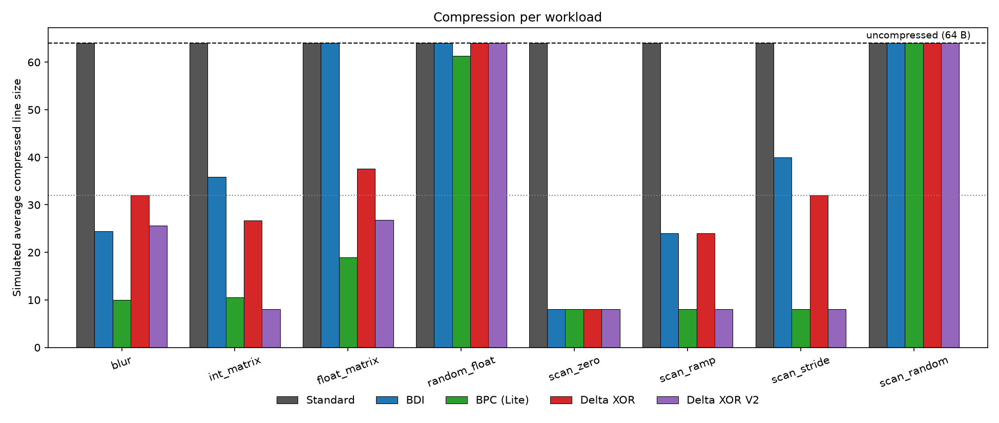

# A cache compression simulator in c++

A small trace driven cache simulator for comparing LLC compressions schemes. Lines are stored raw but every lines calculated size dictates the behaviour, modeling a real compressed cache. Always rounded to bytes with a budget per set with tag limit.


## Preliminary results
After two iterations, deltaXOR is hybrid of existing schemes combining the BDI approach of keeping a reference word as base and adding a delta of delta approach of the Gorilla Facebook



The preliminary results show that the DeltaXOR approaches the BPC in compression ratio while keeping the hardware footprint smaller.

## Notes
- Cache uses 64 B lines, 16 ways, LRU, write-back
- Compression schemes are calculated after size, not actually run
- Workloads are somewhat arbitrary but aims to model real case scenarios. Traces are generated by `tracer.cpp`
- BPC uses a simplified version and BDI is per-word

## Run
```
./make.sh
```

Builds sweep runs for tag limitations and trace + simulation. Writes to results.csv

## References
- Inspiration for the skeleton of the cache: https://github.com/bitlemonsoftware/cache-iq
- Bit-Plane Compression: https://dl.acm.org/doi/epdf/10.1145/3007787.3001172
- XOR Cache: https://dl.acm.org/doi/10.1145/3695053.3730995 and https://www.youtube.com/watch?v=IcFnxf-Hu-w
- Gorilla: https://www.vldb.org/pvldb/vol8/p1816-teller.pdf